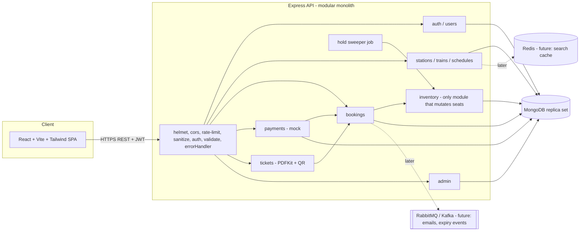
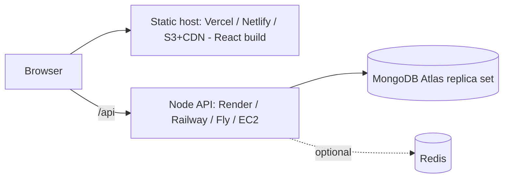

# 2. High-Level Design

**Module rule:** a module calls another module's *service*, never its models (exceptions: read-only existence checks). `inventory.service` is the single writer of seat state, so Redis caching, a queue, or extracting a service later only touches one seam.

## Deployment architecture

HTTPS everywhere; CORS restricted to the frontend origin; secrets only in host environment variables. See `11-deployment.md`.
