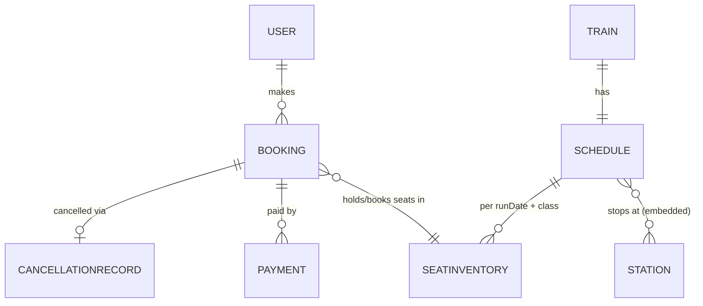
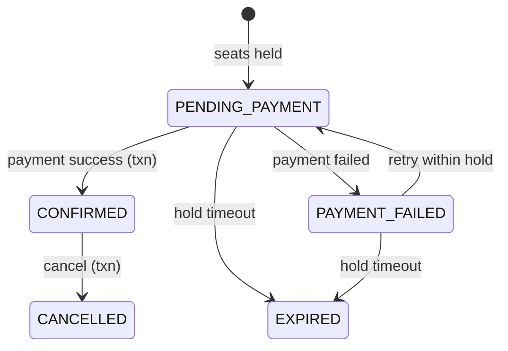

# 4. Database Design

| Collection | Key fields | Indexes |
|---|---|---|
| **users** | name, email, passwordHash (select:false), phone, role, isActive | `email` unique |
| **stations** | code, name, city, state | `code` unique; text(name, city, code) |
| **trains** | number, name, type, classes[{code, baseFarePerKm, reservationCharge, coaches[{name, seats}]}], isActive | `number` unique; text |
| **schedules** | train, runningDays[0-6], stops[{station, stationCode, seq, arrival, departure, dayOffset, distanceKm}] | `train` unique; `stops.stationCode + isActive` |
| **seatinventories** | schedule, train, runDate, classCode, totalSeats, availableCount, seats[{coach, number, status, booking, heldUntil}] | `(schedule, runDate, classCode)` unique; `runDate`; sparse `seats.booking` |
| **bookings** | pnr, user, train snapshot, inventory, runDate, journeyDate, classCode, from/to, departureAt/arrivalAt, passengers[], fare{}, status, holdExpiresAt, inventoryReleased, idempotencyKey, verificationToken, bookedAt, cancelledAt | `pnr` unique (partial); `verificationToken` unique (partial); `(user, idempotencyKey)` unique (partial); `(user, journeyDate)`; `(status, holdExpiresAt)`; `(train, status)` |
| **payments** | booking, user, amount, status, gatewayRef, failureReason, refundedAmount | `booking` unique **where status=INITIATED** (one in-flight payment); `gatewayRef` unique (partial) |
| **cancellationrecords** | booking, pnr, cancelledBy, hoursBeforeDeparture, refundPercent, amountPaid, refundAmount, refundStatus | `booking` **unique** (DB-level guard against double refunds) |

## Rules enforced by the schema
- Seat state per inventory doc: `AVAILABLE | HELD | BOOKED`; `availableCount` never negative.
- A booking keeps **snapshots** (train number/name, station names, times) so tickets never change if an admin edits the train later.
- Money is stored in whole rupees (integers).

## Booking status machine

Every transition is a guarded `findOneAndUpdate({ _id, status: <expected> })`, so racing requests cannot both win.
