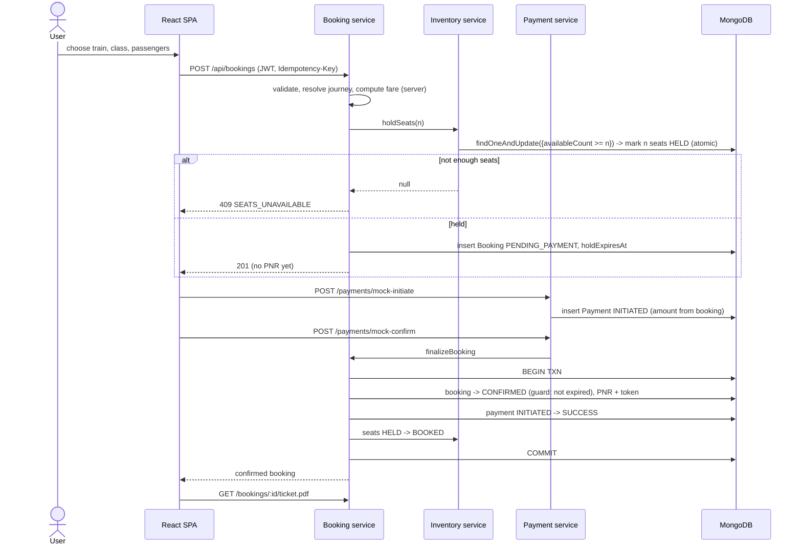
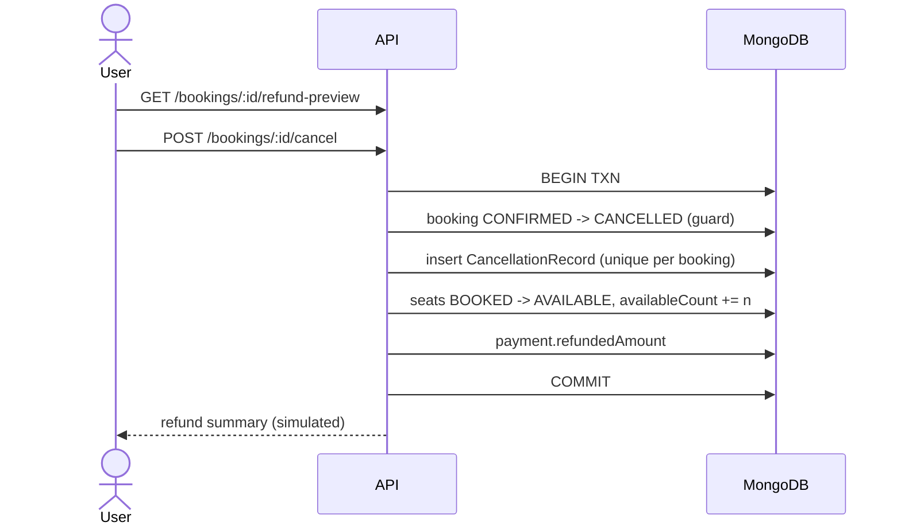

# 5. Booking, Cancellation, Concurrency

## Booking sequence

## Cancellation sequence

## Concurrency strategy
1. **Hold:** one atomic update on the inventory document: filter `availableCount >= n`, aggregation-pipeline update flips the first *n* `AVAILABLE` seats to `HELD` and decrements the counter in the same operation. Verified by tests: 20 simultaneous requests for 4 seats -> exactly 4 succeed, no seat shared.
2. **Confirm:** a transaction guards on booking status + `holdExpiresAt > now`, so it cannot race the sweeper (whoever updates the booking first wins).
3. **Release:** pipeline update restricted to seats whose `booking` equals the given booking; a second release matches nothing, so seats cannot be freed twice.
4. **Idempotency:** booking creation (`Idempotency-Key`), payment initiate (partial unique index), payment confirm (status guards), cancellation (guard + unique cancellation record).
5. **Expiry:** `holdSweeper` flips expired holds to `EXPIRED` with a guarded update, then releases seats (retrying any `EXPIRED` booking with `inventoryReleased=false`, so a crash between the two steps self-heals). Late payments on expired holds return `410 HOLD_EXPIRED`.

## Transaction notes and limitations
- Multi-document transactions need a replica set (Atlas or local `--replSet`). A single standalone `mongod` will fail on confirm/cancel.
- The hot path (hold) deliberately avoids transactions: it is a single-document atomic update.
- A crash between "hold seats" and "insert booking" would strand seats; the sweeper's step 3 releases HELD seats past `heldUntil` (2 min grace) whose booking document does not exist.
