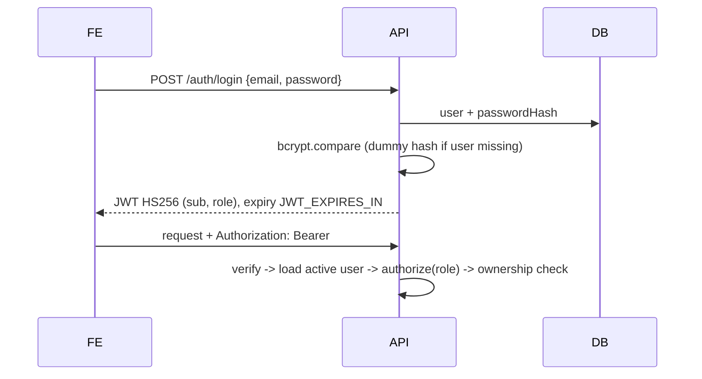

# 6. Authentication, Authorization, Security

| Concern | Control |
|---|---|
| Passwords | bcrypt (cost `BCRYPT_ROUNDS`, default 12), policy: 8-72 chars with letter + digit |
| Enumeration | Identical `INVALID_CREDENTIALS` for unknown user and wrong password, with a dummy-hash compare to even out timing |
| Mass assignment | Zod schemas strip unknown keys; role is never accepted from input; fare/status/PNR/seats are server-computed |
| Injection | Zod types (strings only), `sanitize` strips `$`/`.` keys, regex inputs escaped, no string-built queries |
| AuthZ | `authorize('ADMIN')` on all `/api/admin/*`; booking/payment/ticket ownership checks (403); public endpoints return masked data only |
| Transport/headers | Helmet, CORS allow-list, `x-powered-by` off, 10 KB body limit |
| Abuse | Rate limits (global + stricter on auth), per-user hold cap (`MAX_ACTIVE_HOLDS`), booking cut-off |
| Secrets | Env-only; `JWT_SECRET >= 32 chars` enforced at boot; `.env` git-ignored; seed credentials from env |
| Logging | pino with redaction of `Authorization`, cookies, passwords |
| QR | Contains an opaque 192-bit random token, not a booking id |

**Frontend note:** the token is kept in `localStorage` for simplicity (XSS-exposed). Production upgrade: httpOnly + SameSite cookie with refresh-token rotation and CSRF protection.
